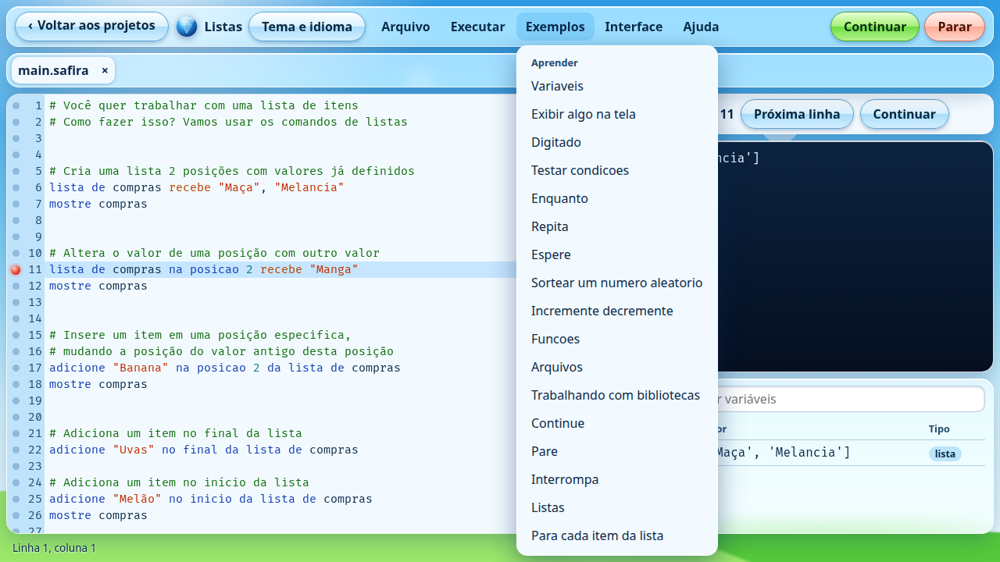

<div align="center">

# Safira

A programming language in natural language for first-time programmers, with a web IDE.


</div>



## About

Safira accepts commands the way a person talks. The same script can mix Portuguese, English and Spanish:

```
idade recebe 18
if idade is greater than 17 { mostre "Maior de idade" }
repeat 2 vezes { show "Oi" }
```

Everything runs in the browser, in a Web Worker. There is no server, and programs have no access to the disk: each
project has its own virtual files, which is where `crie o arquivo`, `leia o arquivo`, `importe` and saving work.

Click the dot beside a line to set a breakpoint: running stops there, and the variables inspector shows the values. On a
phone the IDE splits into Code, Output and Variables panels.

Every screen has an address: `#/new/16-listas`, `#/lessons/aula-02-exibicao/comando-de-exibicao`,
`#/projects/<id>/dados%2Fnotas.txt`. Projects move between browsers as `.zip` files, and unsaved work is kept while typing
so that it comes back after a crash or a power cut.

Every script keeps its language version on a hidden first line (`#safira 1.0`). The IDE only mentions it when the version
is not supported. A script without that line is treated as version 0.38, the last Python release.

## Set up on a new PC

1. Install [nvm](https://github.com/nvm-sh/nvm), then Node 24: `nvm install 24 && nvm use 24`
2. Clone the repository and enter it
3. Enable pnpm and install: `corepack enable && pnpm install`
4. Install the test browser: `pnpm exec playwright install --with-deps chromium`
5. Check everything: `pnpm run check:all`

Projects live in the browser `localStorage`, so they are not in the repository. Use the `.zip` export to move them
between PCs.

## Available scripts

| Script | What it does |
|---|---|
| `pnpm run dev` | Development server |
| `Ctrl+Enter` in the IDE | Runs the program, stopping at the red dots |
| `pnpm run build` | Type check and production build in `build/` |
| `pnpm run preview` | Serves the build on port 5556 |
| `pnpm run lint` / `pnpm run format` | ESLint and TypeScript / Prettier |
| `pnpm run unit` / `pnpm run unit:coverage` | Unit tests, with or without the coverage gate |
| `pnpm run e2e` | Playwright with axe, against the build |
| `pnpm run e2e:resources` | Memory in real use, with `pnpm run preview` running |
| `pnpm run e2e:lighthouse` | Lighthouse floors, with `pnpm run preview` running |
| `pnpm run check:all` | Format, lint, coverage, build and E2E |

## Tests

- `src/language/legacyGolden.json` holds outputs recorded from the original Python interpreter. It is the compatibility
  contract: a whole number is the only accepted difference (`3` instead of `3.0`).
- Each layer has its own tests beside the code: tokenizer, parser, interpreter, runner, projects and interface.
- `e2e/` runs the real worker, with axe in the three themes and layout checks from 320 to 1440 pixels.

## CI/CD

GitHub Actions runs lint, audit, unit tests with a coverage gate, E2E, the memory gate and CodeQL. A merge into `master`
creates the tag and the release. Actions are pinned by commit hash.

## Language

| Layer | Folder | Role |
|---|---|---|
| Tokenizer | `src/language/tokenizer.ts` | Words, numbers, strings, comments |
| Phrases | `src/language/commands.json` | Every command in every language, and its syntax color |
| Parser | `src/language/parser.ts`, `expressionParser.ts` | Syntax tree. An unknown line only fails when it runs, so `tente` can catch it |
| Interpreter | `src/language/interpreter.ts` | A generator that pauses for input, waiting and breakpoints |
| Versions | `src/language/version.ts` | The hidden line and `SUPPORTED_VERSIONS` |

## License

MIT, see [LICENSE](LICENSE).
